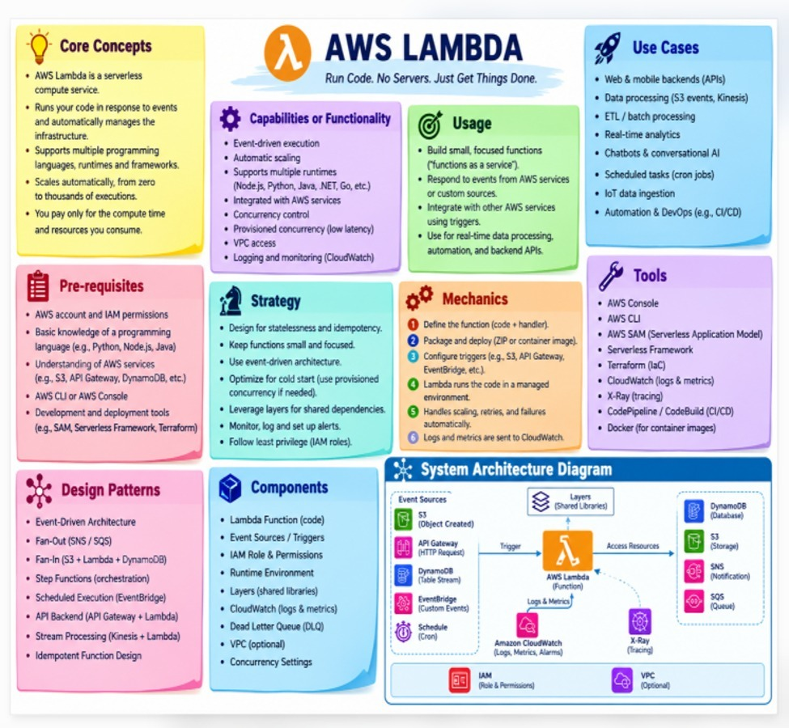

# Sriram_ AWS_Academy_learning ⚡

> **AWS Lambda — Run Code. No Servers. Just Get Things Done.**  
> An interactive student learning web application and hands-on laboratory for mastering AWS serverless computing, design patterns, and event-driven architecture.



---

## 🌟 Overview

This repository provides an end-to-end student curriculum and interactive web portal for learning **AWS Lambda**. Derived directly from the comprehensive AWS Lambda architectural blueprint, it covers foundational theory, execution mechanics, serverless design patterns, and a complete step-by-step practical capstone project.

### 🌐 Live Interactive Website
You can launch the web application locally by opening `index.html` in any browser, or via:
```bash
python -m http.server 3000
# Open http://localhost:3000/
```

---

## 📚 10 Core Learning Modules

1. **💡 Core Concepts**: Serverless computing, event-driven execution, zero-to-thousands automatic scaling, multi-runtime support, and pay-per-millisecond billing.
2. **⚙️ Capabilities & Functionality**: Sub-second execution, provisioned concurrency (zero cold starts), VPC private subnet integration, CloudWatch telemetry.
3. **🎯 Usage Guide**: Function-as-a-Service (FaaS), Single Responsibility Principle, decoupling producers & consumers via event triggers.
4. **🚀 Real-World Use Cases**: Web/mobile REST backends, real-time analytics, automated ETL data pipelines, AI/chatbot webhooks, cron jobs, IoT ingestion.
5. **📋 Prerequisites**: AWS Free Tier account, IAM permissions, Python / Node.js fundamentals, S3, DynamoDB, and AWS CLI.
6. **♞ Architectural Strategy**: Statelessness, idempotency, cold start optimization, Lambda layers for shared dependencies, and least-privilege IAM policies.
7. **⚙️ The 6 Execution Mechanics**:
   - `1. Define Function` → `2. Package & Deploy` → `3. Configure Triggers` → `4. Managed Execution` → `5. Auto Scaling & Retries` → `6. Telemetry & CloudWatch`.
8. **🔧 Tools Ecosystem**: AWS Console, AWS CLI, AWS SAM, Serverless Framework, Terraform, CloudWatch, X-Ray, and Docker container images.
9. **🔀 Design Patterns**: Event-Driven Architecture, Fan-Out (SNS/SQS), Fan-In (S3 + Lambda + DynamoDB), Step Functions orchestration, API backends, and stream processing.
10. **📦 System Components**: Lambda function, event sources, IAM execution roles, layers, Dead Letter Queues (DLQ), and concurrency settings.

---

## 🚀 Hands-On Project: Serverless Image Resizer & Metadata Pipeline

A production-grade serverless pipeline where user uploads to Amazon S3 automatically trigger an AWS Lambda function, extract image metadata, and index the record into Amazon DynamoDB.

### Dual-Language Implementation

- **Python 3.12 (boto3)**: [`lambda_function.py`](lambda_function.py)
- **Node.js 20.x (AWS SDK v3)**: [`index.mjs`](index.mjs)
- **IAM Least Privilege Policy**: [`iam_policy.json`](iam_policy.json)
- **Sample Test Event**: [`sample_event.json`](sample_event.json)

### Key Architectural Safeguards
- **Client Reuse**: AWS SDK clients are instantiated *outside* the handler to leverage socket and connection reuse across warm invocations.
- **Recursion Guard**: Checks for `thumbnails/` prefix to prevent infinite billing loops when writing to the same bucket.
- **100% Free Tier Eligible**: Uses under 1,000,000 monthly invocations, 5 GB S3, and 25 GB DynamoDB capacity.

---

## 📂 Repository Structure

```text
├── index.html                  # Main interactive student learning web app
├── aws_lambda_learning.html    # Secondary direct entrypoint
├── aws_lambda_cheatsheet.jpg   # High-resolution architectural infographic
├── lambda_function.py          # Standalone Python 3.12 Lambda handler
├── index.mjs                   # Standalone Node.js 20.x (ESM) Lambda handler
├── iam_policy.json             # Least-privilege IAM execution policy
├── sample_event.json           # Mock S3 ObjectCreated event for testing
└── README.md                   # Project documentation & study guide
```

---

## 🎓 Developed with
Curated for students & cloud architects by **Sriram_ AWS_Academy_learning**.
